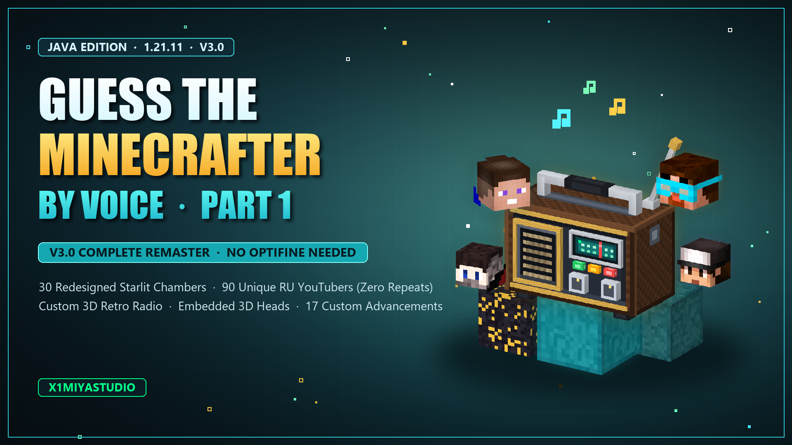
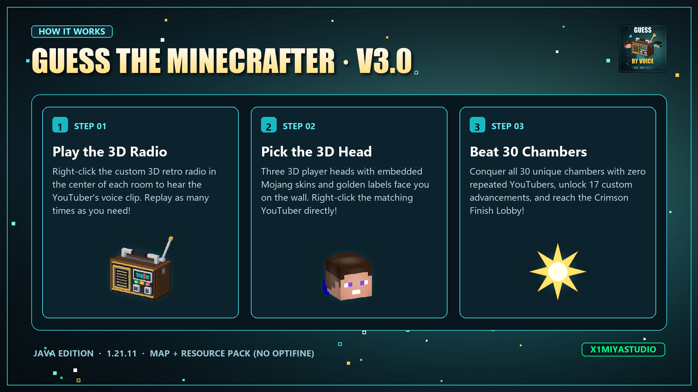
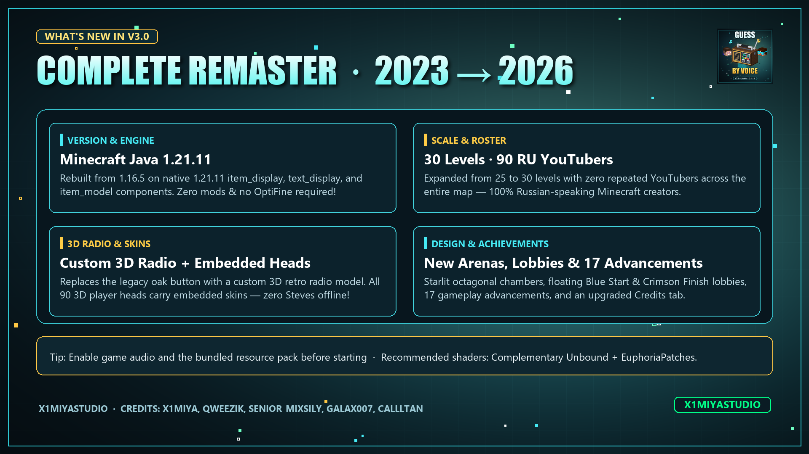

  
  <a href="README_RU.md">
     README_RU.md" />
  </a>

  <b>Complete 1.21.11 remaster of "Guess the Minecrafter by Voice — Part 1" (V3.0).</b> 
  30 redesigned starlit chambers, custom 3D retro radio, 90 unique RU Minecraft YouTubers with embedded skins, and 17 advancements — no OptiFine required!

---

### Features (V3.0 Remaster)

* **30 Redesigned Starlit Chambers** — expanded from 25 to 30 octagonal arenas across 3 rows with synchronized global level tracking (`#player level`), automatic checkpoints, and floating Blue Start & Crimson Finish lobbies.
* **Custom 3D Retro Radio (`x1miya:radio`)** — native 1.21.11 `minecraft:item_model` 3D radio on an `item_display` pedestal with an interactive `voice` hitbox (`minecraft:my_sounds.*`).
* **90 Unique RU YouTubers (Zero Repeats)** — all 90 floating 3D player heads (`item_display`, scale 1.4x) use embedded Mojang skin profiles for instant offline loading with zero Steves.
* **17 Custom Advancements & Upgraded Credits** — full gameplay progression, streak challenges (*5* & *15* in a row, *Flawless 30/30*), 3D radio milestones, a hidden *Sixth Sense* secret, and a redesigned **Credits** tab (`X1miya`, `Qweezik`, `Senior_Mixsily`, `GALaX007`, `CAlllTAN`).
* **Post-Game Rating & Release Prep** — interactive `/trigger rate` 1–5 star rating in the finale lobby and `/function x1miya:prepare_release` for instant clean resets.

---

### Gallery

  
  

---

### Installation

1. Download the **V3.0** release archive and unpack it.
2. Copy the world folder `УМПГЧ1 V3.0` into `.minecraft/saves/` *(auto-loads bundled `resources.zip` in singleplayer!)*.
3. For multiplayer or manual setup, also copy the included Resource Pack ZIP into `.minecraft/resourcepacks/` and enable it in settings.
4. Launch **Minecraft Java 1.21.11** (no mods or OptiFine needed) and play!

---

### License

Distributed under [CC BY-NC-ND 4.0](LICENSE) (Russian translation: [LICENSE_RU.md](LICENSE_RU.md)). Attribution to **X1miya / X1miyaStudio** with a link to the author's channel or project page is required when creating videos or streams.

