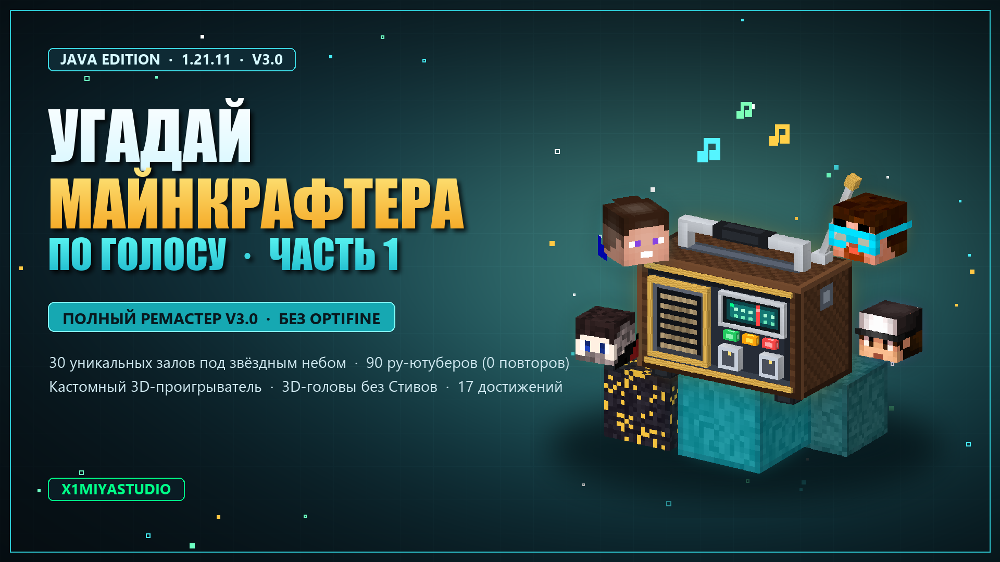
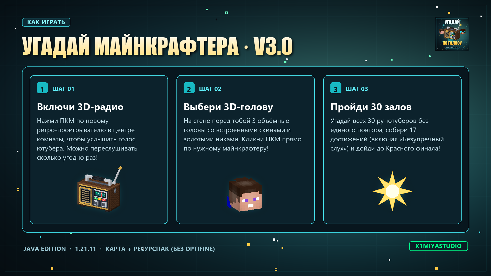
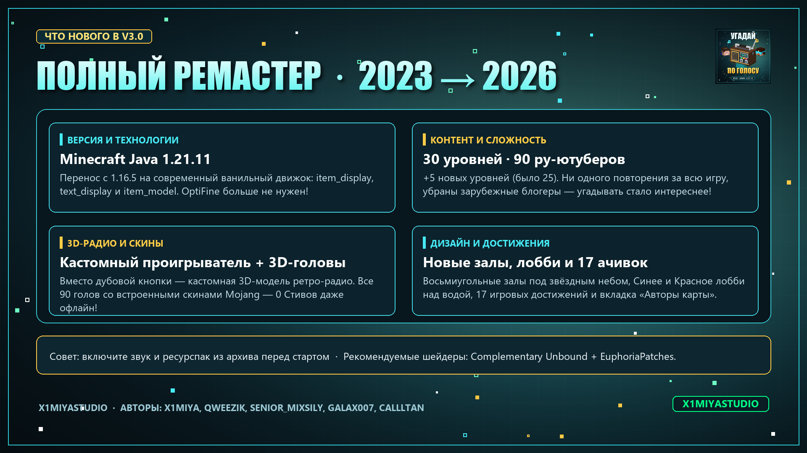

  
  

  <b>Полный ремастер легендарной карты «Угадай Майнкрафтера по голосу — Часть 1» (V3.0) под 1.21.11.</b> 
  30 обновлённых залов под звёздным небом, кастомный 3D-проигрыватель, 90 уникальных ру-ютуберов со встроенными скинами и 17 достижений — без OptiFine!

---

### 🎙 Что нового в V3.0

* **30 перестроенных залов под звёздным небом** — вместо 25 старых комнат теперь 30 восьмиугольных залов в 3 ряда с синхронизацией прогресса (`#player level`), чекпоинтами и новыми парящими Синим и Красным лобби над водой.
* **Кастомный 3D-проигрыватель (`x1miya:radio`)** — объёмная 3D-модель ретро-радио через нативный компонент `minecraft:item_model` (`1.21.11`) вместо старой дубовой кнопки.
* **90 уникальных ру-ютуберов (0 повторов)** — все 90 объёмных 3D-голов (`item_display`, scale 1.4x) со встроенными скинами Mojang прогружаются мгновенно даже офлайн (0 Стивов).
* **17 достижений и обновлённая вкладка авторов** — прогресс по рядам, серии без ошибок (`5`, `15` и `Безупречный слух` 30/30), ачивки за 3D-радио, скрытая секретка «Шестое чувство» и титры команды (`X1miya`, `Qweezik`, `Senior_Mixsily`, `GALaX007`, `CAlllTAN`).
* **Рейтинг и подготовка к релизу** — интерактивная оценка 1–5 звёзд (`/trigger rate`) в финальном лобби и команда `/function x1miya:prepare_release` для мгновенного сброса карты.

---

### 🖼️ Инфографики

  
  

---

### 🚀 Установка

1. Скачайте и распакуйте релизный архив **V3.0**.
2. Скопируйте папку мира `УМПГЧ1 V3.0` в `.minecraft/saves/` *(в одиночной игре встроенный `resources.zip` подхватится автоматически!)*.
3. Для игры с друзьями или ручной установки также скопируйте архив ресурспака в `.minecraft/resourcepacks/` и включите его в настройках.
4. Запустите **Minecraft Java 1.21.11** (OptiFine и моды не требуются) и наслаждайтесь!

---

### 📄 Условия использования

Распространяется под лицензией [CC BY-NC-ND 4.0](LICENSE) ([русская версия условий](LICENSE_RU.md)). Указание авторства **X1miya / X1miyaStudio** и ссылка на оригинальный канал или страницу проекта обязательны при съёмке видео и стримов.

